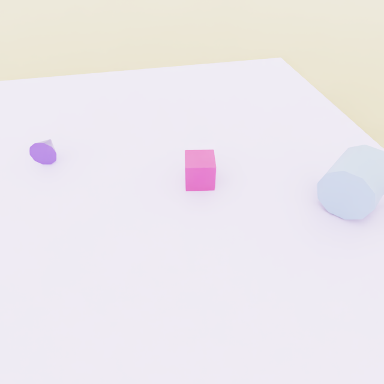
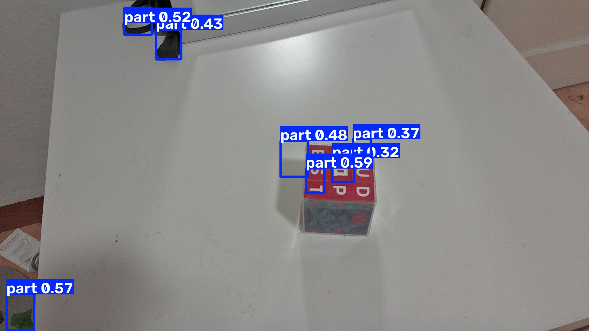
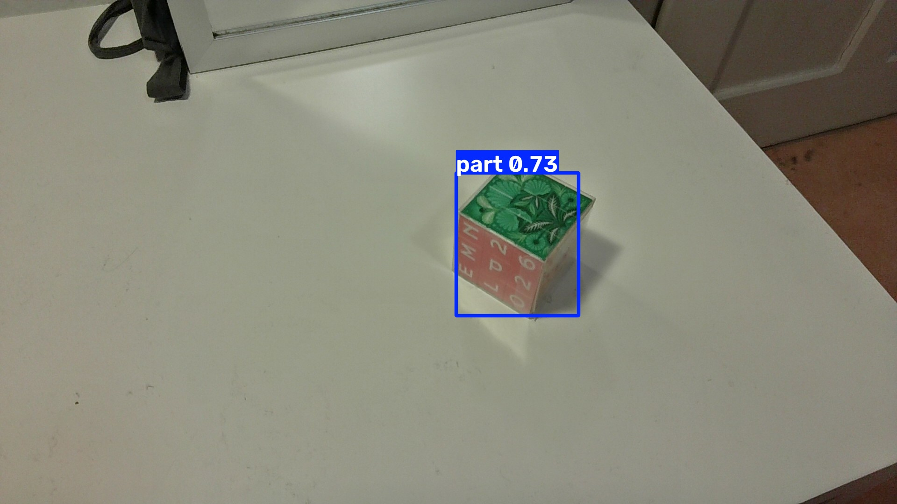

# CAD-to-Robot: from a new part to a robot pick, without manual labelling

**Status: work in progress (week 2).** Synthetic data pipeline, two detector versions and a first sim-to-real test are done. Robot integration is next.

<p align="center">
  
  
  
</p>
<p align="center"><em>Left: randomised synthetic training image (v2). Middle: v1 on a real photo boxes single tiles and a strap, never the whole cube. Right: v2 on a real photo detects the whole cube. No real images were used for training.</em></p>

## The problem

Programming and commissioning are a large share of a robot system's cost, and small manufacturers often wait months for a system integrator. Every new part needs new vision training data, which usually means photographing and labelling hundreds of images by hand.

This project explores a faster path: **generate labelled training images automatically in simulation, train a detector, and hand the detections to a robot**, with every step measured.

## Pipeline

```
Part model -> Isaac Sim synthetic data (randomised) -> labels checked -> YOLO dataset -> YOLO detector
           -> real-photo test -> (next) ROS 2 perception -> pick / place skills -> digital-twin safety check -> robot
```

## Results

### Synthetic validation images

| Run | Training data | Model | Precision | Recall | mAP50 | mAP50-95 | Training time | Inference |
| --- | --- | --- | --- | --- | --- | --- | --- | --- |
| v1 | 500 images: grey cube, grey table, fixed camera | YOLO11n, 50 epochs | 1.00 | 1.00 | 0.995 | 0.954 | 3.2 min | 4.5 ms |
| v2 | 1000 images: random colours, distractors, lighting, camera pose | YOLO11n, 80 epochs | 0.999 | 0.98 | 0.985 | 0.936 | 8.9 min | 3.8 ms |

### Real photos (the test that matters)

29 unique webcam photos of a real 5-6 cm patterned puzzle cube on a white table, bright and dim lighting. The detector never saw a real image during training.

| Run | Whole cube detected | Wrong boxes only (tiles, shadows, strap) | Nothing detected |
| --- | --- | --- | --- |
| v1 (conf 0.25) | 0 / 29 | 8 / 29 | 21 / 29 |
| v2 (conf 0.25) | **8 / 29** | **0 / 29** | 21 / 29 |

**What this shows**

- Near-perfect synthetic scores say little about real performance: v1 scored 0.995 mAP50 on synthetic images and found the whole cube in 0 of 29 real photos.
- v1 learned "small plain grey square", so it boxed single tiles of the real cube and dark objects in the background.
- v2 adds colour randomisation, unlabelled distractor objects (including black ones), random lighting and random camera distance and angle. Wrong boxes dropped to zero and the whole cube is found in 28% of real photos.
- Lowering the confidence threshold to 0.10 added only a few hits and brought back false boxes, so the remaining misses are not a threshold problem. The likely cause: the real cube has patterned 3x3 tile faces with letters, while the training cube only had one plain colour per frame. That is the target of v3.
- Test-set hygiene: the first count used 39 photos, which turned out to include 10 duplicates. All numbers above are on the 29 unique photos.

## Tools

- NVIDIA Isaac Sim 6.2 with Omniverse Replicator (synthetic data)
- Ultralytics YOLO11, PyTorch 2.11 with CUDA
- Hardware: laptop with RTX 3060 (6 GB), 16 GB RAM

## Repository structure

```
scenes/work_cell.usd             Franka arm, table and test part, built in the Isaac Sim GUI
scripts/02_generate_data.py      v1: fixed camera, grey cube, random position and lighting
scripts/02_generate_data_v2.py   v2: random colours, distractors, sun light, random camera pose
scripts/03_check_labels.py       Draws the saved boxes onto images to verify labels visually
scripts/04_to_yolo.py            Converts Isaac Sim output to a YOLO dataset (90/10 train/val split)
runs/v1/, runs/v2/               Training results and trained models (best.pt)
docs/                            Images used in this README
```

## How to run

```bat
:: 1. Generate synthetic data (Isaac Sim's Python)
C:\isaacsim\python.bat scripts\02_generate_data_v2.py
C:\isaacsim\python.bat scripts\03_check_labels.py

:: 2. Convert and train (separate Python environment)
python -m venv .venv
.venv\Scripts\activate
pip install torch torchvision --index-url https://download.pytorch.org/whl/cu128
pip install ultralytics
python scripts\04_to_yolo.py
yolo detect train data=data\yolo_v2\data.yaml model=yolo11n.pt epochs=80 imgsz=640 batch=16 workers=2 project=runs name=v2

:: 3. Test on real photos
yolo detect predict model=runs\v2\weights\best.pt source=data\real_test conf=0.25 project=runs name=real_v2
```

## What went wrong and how I fixed it

- **Half-rendered first frames.** The first captured frames showed editor grid lines and incomplete lighting. Cause: the renderer had not converged yet. Fix: 8 render subframes per capture.
- **Missing labels in 20-40% of images (v1).** Drawing the labels on the images showed the camera looking horizontally and the part floating or hidden inside the table. Cause: the new stage was not Z-up, so "sideways" randomisation became random height. Fix: set the stage to Z-up and metres explicitly.
- **539 of 1000 images without the part (v2, first attempt).** Check images showed upside-down, horizontal camera views. Cause: the Replicator camera kept its own built-in rotation, which combined with my look-at transform. Fix: a plain camera controlled by a single transform, plus a few update ticks before each capture. Result: 999 of 1000 images labelled, box sizes from 21 to 116 px.
- **Per-face colours rendered white.** The cube primitive ignores per-face display colours. Fix for now: one random colour per frame. Textures are planned for v3.

## Next steps

- [ ] v3: image textures (tiles, letters, patterns) on the part and darker scenes; retest on the same 29 photos
- [ ] Measure how many labelled real images close the remaining gap
- [ ] Load real parts from CAD files instead of a cube
- [ ] ROS 2 perception node and robot pick in simulation
- [ ] Digital-twin safety check before execution

## Author

Venkatesh Vishal Patil, M.Sc. AI & Robotics, Hochschule Hof
