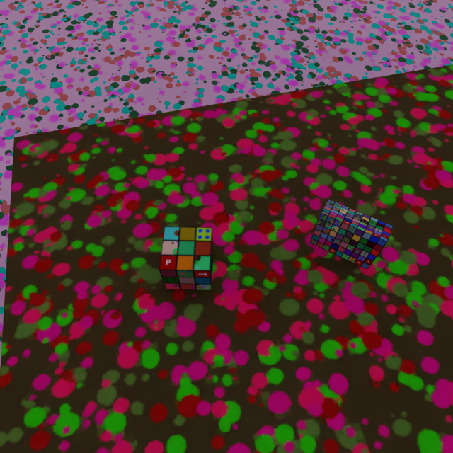
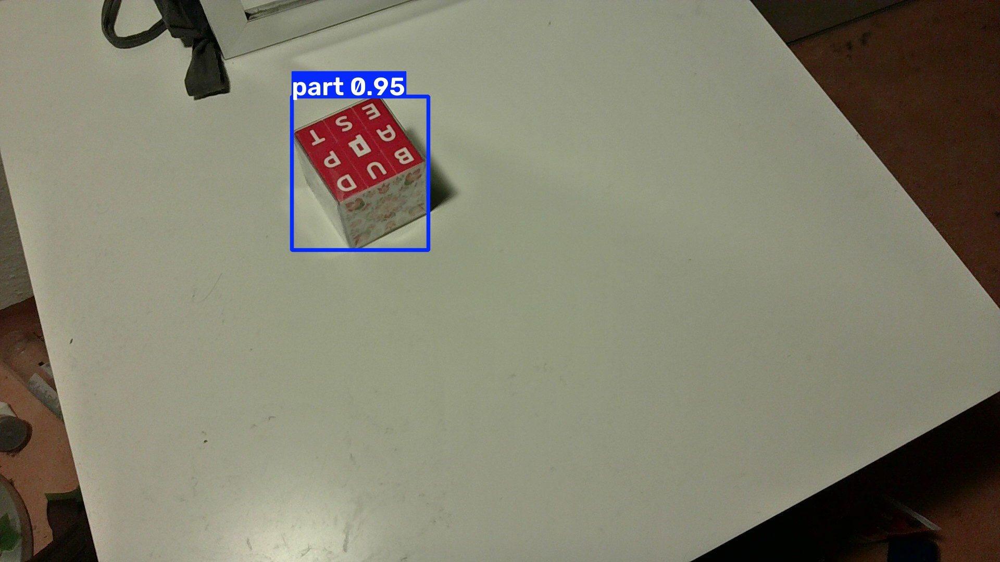

# CAD-to-Robot: from a new part to a robot pick, without manual labelling

**Status: work in progress (week 2).** Synthetic data pipeline, four detector versions and sim-to-real tests are done. Next: 3D-printed parts designed in code, then a real robot pick.

<p align="center">
  
  
  
</p>
<p align="center"><em>Left: v4 training image. The part sits next to a flat box with the same kind of print, so only the cube shape marks the part. Middle: v3 on a real photo boxes clutter at the edges. Right: v4 on the same photo boxes only the cube. No real images were used for training.</em></p>

## The problem

Programming and commissioning are a large share of a robot system's cost, and small manufacturers often wait months for a system integrator. Every new part needs new vision training data, which usually means photographing and labelling hundreds of images by hand.

This project explores a faster path: **generate labelled training images automatically in simulation, train a detector, and hand the detections to a robot**, with every step measured.

## Pipeline

```
Part model (CAD) -> Isaac Sim synthetic data (randomised) -> labels checked -> YOLO dataset -> YOLO detector
                 -> real-photo test -> (next) ROS 2 perception -> pick / place skills -> digital-twin safety check -> robot
```

## Results

### Real photos

29 unique webcam photos of a real 5-6 cm patterned puzzle cube (in a clear plastic case) on a white table: 19 in normal light, 10 very dark. The detector never saw a real image during training.

| Run | Whole cube, no other box | Whole cube + extra wrong boxes | Wrong boxes only | Nothing detected |
| --- | --- | --- | --- | --- |
| v1 (conf 0.25) | 0 / 29 | 0 / 29 | 8 / 29 | 21 / 29 |
| v2 (conf 0.25) | 8 / 29 | 0 / 29 | 0 / 29 | 21 / 29 |
| v3 (conf 0.25) | 14 / 29 | 15 / 29 | 0 / 29 | 0 / 29 |
| v4 (conf 0.25) | 20 / 29 | **0 / 29** | **0 / 29** | 9 / 29 |
| v4 (conf 0.15) | 21 / 29 | **0 / 29** | **0 / 29** | 8 / 29 |

### Plain parts (does the model depend on the pattern?)

All models tested on the same 100 validation images of **plain, single-colour** cubes from v2:

| Model | Precision | Recall | mAP50 | mAP50-95 |
| --- | --- | --- | --- | --- |
| v2 (trained on plain cubes) | 0.999 | 0.98 | 0.985 | 0.936 |
| v3 (trained on patterned cubes) | 0.833 | 0.75 | 0.726 | 0.659 |
| v4 (patterned + 25% plain, textured clutter) | 0.98 | **0.968** | **0.981** | 0.918 |

### Synthetic validation images (own validation set)

| Run | Training data | Model | Precision | Recall | mAP50 | mAP50-95 | Training time | Inference |
| --- | --- | --- | --- | --- | --- | --- | --- | --- |
| v1 | 500 images: grey cube, grey table, fixed camera | YOLO11n, 50 epochs | 1.00 | 1.00 | 0.995 | 0.954 | 3.2 min | 4.5 ms |
| v2 | 1000 images: random colours, distractors, lighting, camera pose | YOLO11n, 80 epochs | 0.999 | 0.98 | 0.985 | 0.936 | 8.9 min | 3.8 ms |
| v3 | 1000 images: v2 + textured part, darker scenes | YOLO11n, 80 epochs | 0.99 | 1.00 | 0.995 | 0.951 | 8.9 min | 3.3 ms |
| v4 | 1000 images: textures everywhere, plain part 25%, box clutter | YOLO11n, 80 epochs | 0.999 | 1.00 | 0.995 | 0.937 | 8.9 min | 3.6 ms |

## What this shows

- **Synthetic scores say almost nothing about real performance.** All four versions score about 0.99 mAP50 on their own synthetic images; on real photos they range from 0 to 29 hits.
- **Each version removed one shortcut the model had learned**, found by testing on real photos:
  - v1 learned "small plain grey square" and boxed single tiles and dark background objects.
  - v2 (random colours, distractors, lighting, camera pose) removed the false boxes but only knew plain cubes: 8/29.
  - v3 put generated textures (tiles, letters, flowers) on the part and added dark scenes: 29/29, but the part was the only textured object in the scene, so the model learned "detailed = part" and boxed clutter in 15 photos. Tested on plain cubes, its recall dropped to 0.75: it had become dependent on the pattern.
  - v4 puts textures on the floor, table and new box-shaped clutter (including flat boxes printed with the same tile patterns as the part), and makes the part plain 25% of the time. Only the cube **shape** stays constant. Result: **zero wrong boxes on real photos** and plain-part recall back to 0.97.
- **The remaining v4 misses are understood.** The missed photos show cube faces where one picture runs across all 9 tiles (leaves, flowers, a mandala); in v4's training data, that kind of print only appeared on clutter. One miss has the cube in the image corner, while the synthetic camera always aimed near the part. Lowering the threshold to 0.10 recovers only one photo, so the model is confidently wrong, not unsure.
- **Why I stopped tuning on this cube.** v3 and v4 were both developed against the same 29 photos; adding "picture faces" now would fit the training data to the test set. Real factory parts are mostly plain, so the next step is a plain part designed in CAD and 3D-printed, with a new, untouched test set.
- **Measured, not guessed:** real-photo brightness was compared with the synthetic images (dark ~35, normal ~130 on 0-255); test-set duplicates were removed (39 -> 29 photos).

## Next part: designed in code, 3D-printed

`scripts/00_make_part.py` builds two plain test parts with numpy only, as watertight meshes (STL in mm for printing, OBJ in metres for Isaac Sim):

- **Part A, V-block** (30 x 50 x 25 mm): side profile with V-groove, relief slot and chamfers, extruded 50 mm.
- **Part B, flanged bushing** (diameter 40 x 30 mm, 12 mm bore): half cross-section revolved around the axis, like a lathe.

Every size is a setting, so a new part variant is one edit away. Part B will be used to time the full "new part to detector" run.

## How the synthetic scenes are built

- **Part as a mesh with UVs.** The built-in cube shape has no texture coordinates, so the part is a mesh built in the script, each face mapped to one cell of a texture atlas.
- **Two looks per object.** Part, table, floor and clutter boxes each have a texture material and a plain material; every frame picks one. Textures are drawn with Pillow: cube faces (`01_make_textures.py`) and backgrounds such as wood, tiles, speckle and packaging print (`01_make_bg_textures.py`).
- **Clutter that is never the part.** Box distractors always have one side at least twice as long as another, so no clutter box is a cube.
- **Warm-up.** Every texture is shown once before capture, so no frame is saved with an unloaded texture.

## Tools

- NVIDIA Isaac Sim 6.2 with Omniverse Replicator (synthetic data), USD (meshes, UVs, UsdPreviewSurface materials)
- Ultralytics YOLO11, PyTorch 2.11 with CUDA, Pillow, numpy
- Hardware: laptop with RTX 3060 (6 GB), 16 GB RAM. 1000 images render in about 6-8 minutes, training takes 9 minutes.

## Repository structure

```
scenes/work_cell.usd             Franka arm, table and test part, built in the Isaac Sim GUI
scripts/00_make_part.py          Designs the test parts (V-block, flanged bushing) -> STL + OBJ
scripts/01_make_textures.py      100 random cube-face texture atlases (tiles, letters, flowers)
scripts/01_make_bg_textures.py   60 background textures (wood, tiles, speckle, packaging, ...)
scripts/02_generate_data.py      v1: fixed camera, grey cube
scripts/02_generate_data_v2.py   v2: random colours, distractors, sun light, random camera pose
scripts/02_generate_data_v3.py   v3: textured mesh part, darker scenes
scripts/02_generate_data_v4.py   v4: textures everywhere, plain parts, box clutter on table and floor
scripts/03_check_labels.py       Draws the saved boxes onto images to verify labels visually
scripts/04_to_yolo.py            Converts Isaac Sim output to a YOLO dataset (90/10 train/val split)
cad/                             Generated part models (STL, OBJ) and preview
runs/v1/ ... runs/v4/            Training results and trained models (best.pt)
docs/                            Images used in this README
```

## How to run

```bat
:: 0. Python environment for textures, conversion and training
python -m venv .venv
.venv\Scripts\activate
pip install torch torchvision --index-url https://download.pytorch.org/whl/cu128
pip install ultralytics

:: 1. Textures
python scripts\01_make_textures.py
python scripts\01_make_bg_textures.py

:: 2. Synthetic data (Isaac Sim's Python), then check the labels
C:\isaacsim\python.bat scripts\02_generate_data_v4.py
python scripts\03_check_labels.py

:: 3. Convert and train
python scripts\04_to_yolo.py
yolo detect train data=data\yolo_v4\data.yaml model=yolo11n.pt epochs=80 imgsz=640 batch=16 workers=2 project=runs name=v4

:: 4. Test on real photos and on plain parts
yolo detect predict model=runs\v4\weights\best.pt source=data\real_test conf=0.25 project=runs name=real_v4
yolo detect val model=runs\v4\weights\best.pt data=data\yolo_v2\data.yaml project=runs name=v4_on_v2plain
```

## What went wrong and how I fixed it

- **Half-rendered first frames.** The first frames showed editor grid lines and incomplete lighting: the renderer had not converged. Fix: 8 render subframes per capture.
- **Missing labels in 20-40% of images (v1).** Drawing the labels on the images showed the part floating or hidden inside the table: the new stage was not Z-up. Fix: set Z-up and metres explicitly.
- **539 of 1000 images without the part (v2, first attempt).** The Replicator camera kept its own built-in rotation, which combined with my look-at transform. Fix: a plain camera controlled by one transform, plus update ticks before each capture. Result: 999 of 1000 images labelled.
- **Per-face colours rendered white (v2).** The built-in cube primitive has no texture coordinates. Fix in v3: a mesh with explicit UVs and a texture material.
- **A better model that was worse.** v3 improved the real-photo hit rate but, tested on the old plain-cube images, recall fell from 0.98 to 0.75. Checking new models on old data is now a fixed step.

## Next steps

- [ ] Print the V-block and the bushing (MakerSpace), take a new test set from a fixed camera position (raw and region-of-interest results)
- [ ] Synthetic data from the CAD part, with the part anywhere in the frame
- [ ] Time the full "new part to detector" run with Part B
- [ ] Measure how many labelled real images close the remaining gap
- [ ] ROS 2 perception node, robot pick, digital-twin safety check

## Author

Venkatesh Vishal Patil, M.Sc. AI & Robotics, Hochschule Hof
