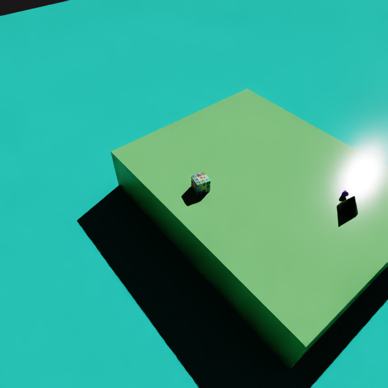
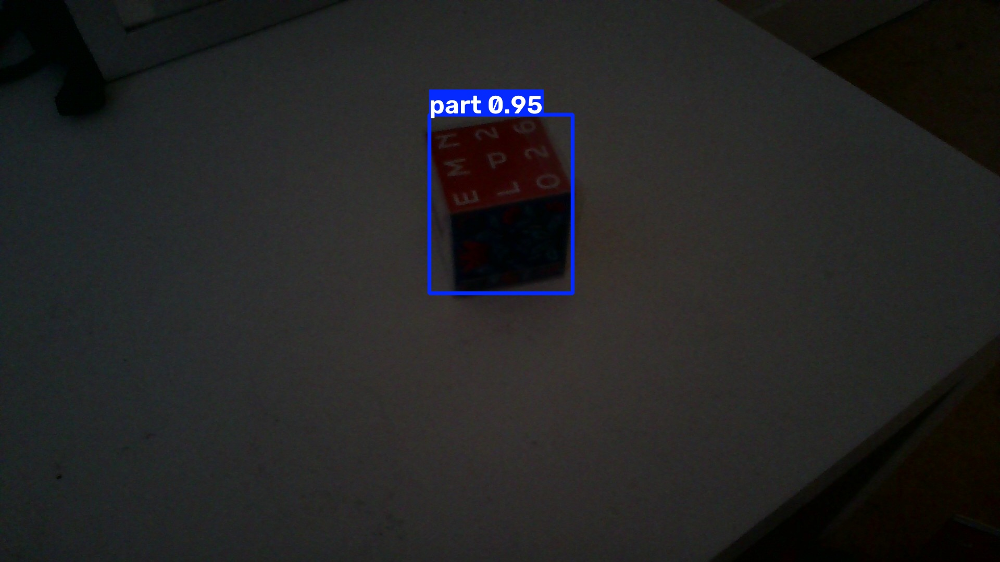
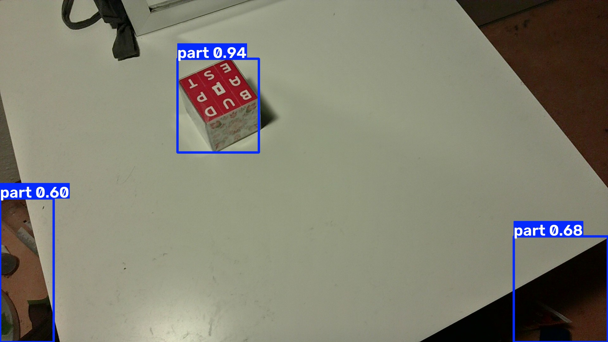

# CAD-to-Robot: from a new part to a robot pick, without manual labelling

**Status: work in progress (week 2).** Synthetic data pipeline, three detector versions and a sim-to-real test on real photos are done. Robot integration is next.

<p align="center">
  
  
  
</p>
<p align="center"><em>Left: synthetic training image (v3), textured part. Middle: v3 finds the cube in a dark real photo. Right: v3 finds the cube but also boxes clutter at the image edges, the problem v4 targets. No real images were used for training.</em></p>

## The problem

Programming and commissioning are a large share of a robot system's cost, and small manufacturers often wait months for a system integrator. Every new part needs new vision training data, which usually means photographing and labelling hundreds of images by hand.

This project explores a faster path: **generate labelled training images automatically in simulation, train a detector, and hand the detections to a robot**, with every step measured.

## Pipeline

```
Part model -> Isaac Sim synthetic data (randomised) -> labels checked -> YOLO dataset -> YOLO detector
           -> real-photo test -> (next) ROS 2 perception -> pick / place skills -> digital-twin safety check -> robot
```

## Results

### Real photos (the test that matters)

29 unique webcam photos of a real 5-6 cm patterned puzzle cube (in a clear plastic case) on a white table: 19 in normal light, 10 very dark. The detector never saw a real image during training. Confidence threshold 0.25.

| Run | Whole cube, no other box | Whole cube + extra wrong boxes | Wrong boxes only | Nothing detected |
| --- | --- | --- | --- | --- |
| v1 | 0 / 29 | 0 / 29 | 8 / 29 | 21 / 29 |
| v2 | 8 / 29 | 0 / 29 | 0 / 29 | 21 / 29 |
| v3 | **14 / 29** | 15 / 29 | 0 / 29 | **0 / 29** |

**v3 finds the whole cube in 29 of 29 photos**, including all 10 dark ones, and the highest-confidence box is on the cube every time.

### Synthetic validation images

| Run | Training data | Model | Precision | Recall | mAP50 | mAP50-95 | Training time | Inference |
| --- | --- | --- | --- | --- | --- | --- | --- | --- |
| v1 | 500 images: grey cube, grey table, fixed camera | YOLO11n, 50 epochs | 1.00 | 1.00 | 0.995 | 0.954 | 3.2 min | 4.5 ms |
| v2 | 1000 images: random colours, distractors, lighting, camera pose | YOLO11n, 80 epochs | 0.999 | 0.98 | 0.985 | 0.936 | 8.9 min | 3.8 ms |
| v3 | 1000 images: v2 + textured part (tiles, letters, flowers), darker scenes | YOLO11n, 80 epochs | 0.99 | 1.00 | 0.995 | 0.951 | 8.9 min | 3.3 ms |

### What this shows

- **Synthetic scores say almost nothing about real performance.** All three versions score about 0.99 mAP50 on synthetic images; on real photos they range from 0 to 29 hits.
- **Each version removed one shortcut the model had learned:**
  - v1 learned "small plain grey square" and boxed single tiles and dark background objects.
  - v2 (random colours, distractor objects, lighting, camera pose) removed the false boxes, but only knew "one plain colour per cube" and missed patterned faces and dark photos (8/29).
  - v3 puts generated textures on the part (3x3 tiles with letters, flowers, stripes and dots) and adds much darker scenes. The cube is now found in every photo.
- **New shortcut in v3:** in the synthetic scenes the part was the only textured object, so the model learned "detailed = part". 15 photos get extra boxes, all on clutter at the photo edges (floor, table corner, packaging), never on the cube's tiles. v4 will put textures on the floor, table and distractor objects to remove this shortcut.
- **Lighting was measured, not guessed:** mean image brightness of the real photos (dark ~35, normal ~130 on 0-255) was compared with the synthetic images to make sure v3 covers both.
- Lowering the threshold is not the fix: for v2, a threshold of 0.10 added only a few hits and brought back false boxes.
- Test-set hygiene: the first count used 39 photos, which included 10 duplicates. All numbers are on the 29 unique photos.

## How v3 textures the part

The built-in cube shape has no texture coordinates, so the v3 part is a mesh built in the script: 6 faces, each with UV coordinates that point to one cell of a texture "atlas" (one image with all 6 faces in a 3x2 grid). `01_make_textures.py` draws 100 random atlases with Pillow; each frame wraps a random one around the part. A warm-up pass shows every texture once before capture, so no frame is saved with an unloaded (grey) texture.

## Tools

- NVIDIA Isaac Sim 6.2 with Omniverse Replicator (synthetic data), USD (meshes, UVs, UsdPreviewSurface materials)
- Ultralytics YOLO11, PyTorch 2.11 with CUDA, Pillow
- Hardware: laptop with RTX 3060 (6 GB), 16 GB RAM. 1000 v3 images render in about 6 minutes.

## Repository structure

```
scenes/work_cell.usd             Franka arm, table and test part, built in the Isaac Sim GUI
scripts/01_make_textures.py      v3: draws 100 random cube-face texture atlases (tiles, letters, flowers)
scripts/02_generate_data.py      v1: fixed camera, grey cube, random position and lighting
scripts/02_generate_data_v2.py   v2: random colours, distractors, sun light, random camera pose
scripts/02_generate_data_v3.py   v3: textured mesh part, darker scenes, part tipped onto any face
scripts/03_check_labels.py       Draws the saved boxes onto images to verify labels visually
scripts/04_to_yolo.py            Converts Isaac Sim output to a YOLO dataset (90/10 train/val split)
runs/v1/, runs/v2/, runs/v3/     Training results and trained models (best.pt)
docs/                            Images used in this README
```

## How to run

```bat
:: 1. Textures (training venv, needs Pillow)
python scripts\01_make_textures.py

:: 2. Generate synthetic data (Isaac Sim's Python)
C:\isaacsim\python.bat scripts\02_generate_data_v3.py
python scripts\03_check_labels.py

:: 3. Convert and train (separate Python environment)
python -m venv .venv
.venv\Scripts\activate
pip install torch torchvision --index-url https://download.pytorch.org/whl/cu128
pip install ultralytics
python scripts\04_to_yolo.py
yolo detect train data=data\yolo_v3\data.yaml model=yolo11n.pt epochs=80 imgsz=640 batch=16 workers=2 project=runs name=v3

:: 4. Test on real photos
yolo detect predict model=runs\v3\weights\best.pt source=data\real_test conf=0.25 project=runs name=real_v3
```

## What went wrong and how I fixed it

- **Half-rendered first frames.** The first captured frames showed editor grid lines and incomplete lighting. Cause: the renderer had not converged yet. Fix: 8 render subframes per capture.
- **Missing labels in 20-40% of images (v1).** Drawing the labels on the images showed the camera looking horizontally and the part floating or hidden inside the table. Cause: the new stage was not Z-up, so "sideways" randomisation became random height. Fix: set the stage to Z-up and metres explicitly.
- **539 of 1000 images without the part (v2, first attempt).** Check images showed upside-down, horizontal camera views. Cause: the Replicator camera kept its own built-in rotation, which combined with my look-at transform. Fix: a plain camera controlled by a single transform, plus a few update ticks before each capture. Result: 999 of 1000 images labelled, box sizes from 21 to 116 px.
- **Per-face colours rendered white (v2).** The built-in cube primitive ignores per-face display colours and has no texture coordinates. Fix in v3: build the cube as a mesh with explicit UVs and a texture material.

## Next steps

- [ ] v4: textures on floor, table and distractors, plus box-shaped distractors, to remove the "detailed = part" shortcut; retest on the same 29 photos
- [ ] Measure how many labelled real images close the remaining gap
- [ ] Load real parts from CAD files instead of a cube
- [ ] ROS 2 perception node and robot pick in simulation
- [ ] Digital-twin safety check before execution

## Author

Venkatesh Vishal Patil, M.Sc. AI & Robotics, Hochschule Hof
